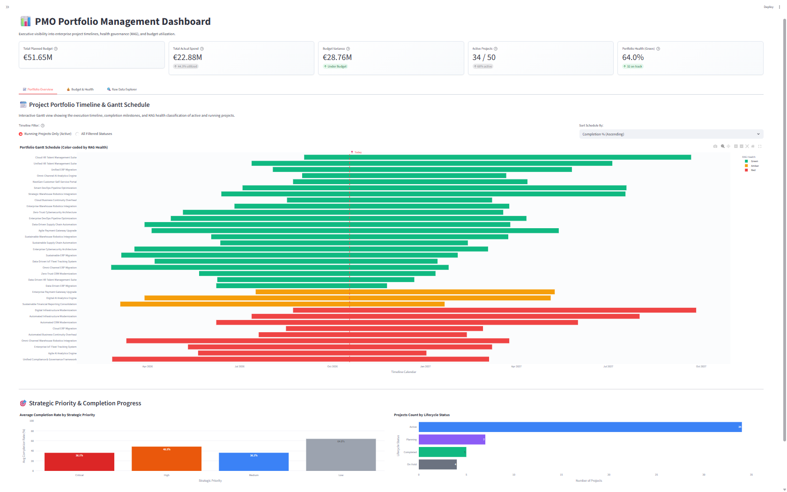
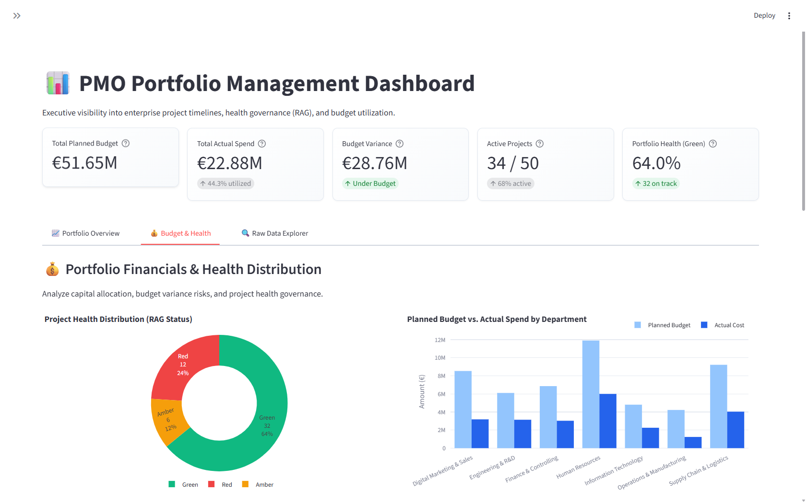
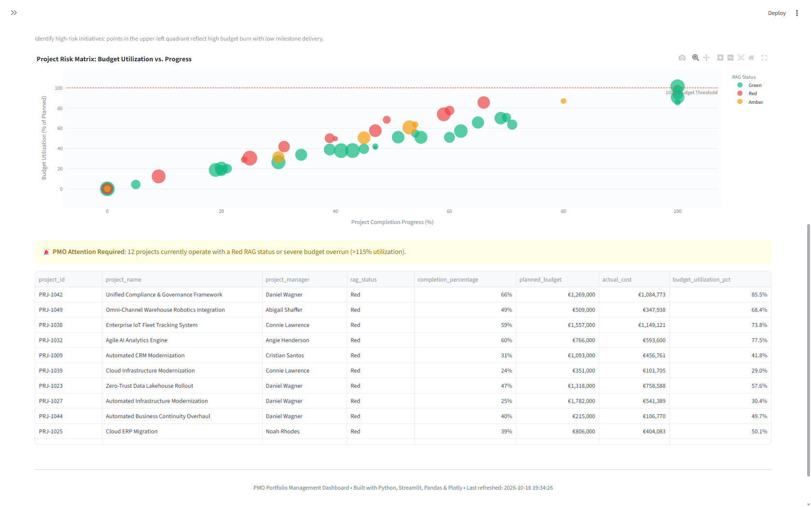

# 📊 PMO Portfolio Management Dashboard

[](https://www.python.org/)
[](https://streamlit.io/)
[](https://plotly.com/)
[](LICENSE)

An enterprise-grade, modular Project Management Office (PMO) analytics platform and interactive [Streamlit](https://streamlit.io/) dashboard designed to provide executive visibility into organizational project portfolios, Gantt execution schedules, financial budget utilization, and RAG health governance.

---

## 🌟 Key Features

- **Synthetic Data Engineering (`src/generate_pmo_data.py`)**:
  - Automated generation of realistic enterprise project portfolios using `Faker`, `NumPy`, and `Pandas`.
  - Realistic multi-factor modeling of project budgets, actual expenditures, completion percentages, lifecycle phases, and RAG health statuses (`Green`, `Amber`, `Red`).
  - Dynamic, secure directory and path resolution using Python's standard `pathlib`.
  - Deterministic reproducibility via configurable random seeds and CLI parameterization (`--num-projects`, `--seed`, `--output`).

- **High-Performance Data Processing (`src/data_processing.py`)**:
  - Robust type validation, datetime sanitization, and automated fallback data synthesis.
  - Derived business intelligence metrics: budget variance, budget utilization percentage, project duration, and health indices.
  - Standardized hex color mapping for RAG health governance (`#10b981`, `#f59e0b`, `#ef4444`).
  - Sub-second dashboard load times powered by Streamlit caching (`@st.cache_data`).

- **Interactive Executive Dashboard (`app.py`)**:
  - **Dynamic Sidebar Controls**: Filter by project status, RAG health, project manager, department, custom date range horizon, and real-time free-text keyword search.
  - **Executive KPI Cards**: Real-time totals for Planned Budget, Actual Spend, Net Budget Variance, Active vs. Total Projects, and Overall Portfolio Health (% Green).
  - **Tab 1: Portfolio Overview**:
    - Interactive Plotly Gantt timeline chart with dynamic sorting, RAG color coding, detailed hover cards, and a real-time calendar marker for today's date.
    - Strategic priority and lifecycle completion breakdown charts.
  - **Tab 2: Budget & Health**:
    - Project health distribution donut chart (RAG breakdown).
    - Planned Budget vs. Actual Spend comparison grouped by organizational department.
    - Project risk matrix scatter plot (Budget Utilization vs. Completion Progress) highlighting early warning anomalies and projects exceeding 100% budget.
    - Escalated initiatives alert panel for red projects needing PMO intervention.
  - **Tab 3: Raw PMO Data Explorer**:
    - Embedded within a collapsible `st.expander("🔍 Explore Raw PMO Data")`.
    - Interactive `st.dataframe()` with custom column formatting (currency formatting, progress indicators, date formatters).
    - One-click CSV export of the active filtered portfolio.

---

## 📸 Dashboard Screenshots

### 1. Project Portfolio Timeline (Gantt Schedule)


### 2. Portfolio Financials & Health Distribution


### 3. Risk Matrix (Budget Utilization vs. Progress)


---

## 🏗️ Project Architecture

```text
PMO-Portfolio-Management-Dashboard/
│
├── .gitignore                   # Version control exclusions for cache & virtual envs
├── LICENSE                      # Project open source license
├── README.md                    # Comprehensive documentation and quickstart
├── requirements.txt             # Python project dependencies
├── pytest.ini                   # Pytest test suite configuration
├── app.py                       # Main Streamlit dashboard application entry point
│
├── data/                        # Dynamic dataset storage directory
│   ├── .gitkeep                 # Folder persistence placeholder
│   └── pmo_projects.csv         # Generated synthetic PMO portfolio dataset
│
├── src/                         # Modular business logic and data engineering package
│   ├── __init__.py              # Python package initializer
│   ├── generate_pmo_data.py     # Faker-based synthetic PMO data generation script
│   └── data_processing.py       # Caching, datetime sanitization, RAG coloring & KPIs
│
└── tests/                       # Automated unit and integration test suite
    └── test_pmo_dashboard.py    # Test specifications for generation, processing & filtering